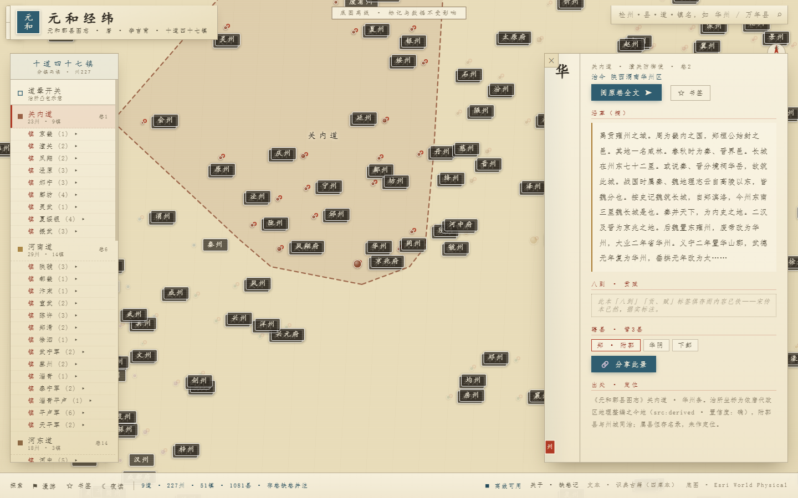

# 元和经纬 · 元和郡县图志

《元和郡县图志》（唐·李吉甫，元和八年 813 成书）数字人文站——十道四十七镇州县舆图、
分镇循读、全书全文检索。文本自识典古籍（钦定四库全书本）逐章抓取解析，缺卷如实标注。

## 打开

```
python -m http.server 9600
# http://127.0.0.1:9600/index.html
```

`YH_BASE` 环境变量可覆盖测试基准。深链自动写回地址栏：

- `#dao=guannei&zhou=华州` —— 道内选中州（刷新/分享保持）
- `#dao=guannei&zhen=京畿观察使` —— 镇视角直达（纲目展开 + 所领州聚焦）
- `#xref=1` —— 直达「唐宋对照」页签
- `#search=渭水` —— 直达一次检索

快捷键：`Esc` 收面板 · `?` 关于·缺卷记 · `/` 聚焦检索。

> **姊妹站互链约定**：站内「唐宋」页签的 ↗寰宇 深链用相对兄弟路径 `../TPHY/`——
> 需以父目录同根起服务（在 `D:\W_A_W` 起 `python -m http.server` 后
> `/YHJZ/`、`/TPHY/` 同源可达）；仅本站单服务时该链接不越站，不影响其余功能。

## 全书与缺卷（如实标注）

原书**起京兆府，尽陇右道，凡四十七镇，成四十卷，并目录两卷**（合四十二卷，李吉甫原序）。
图至南宋已亡，故传本称《元和郡县志》。据四库全书总目提要，此本：

- **缺卷十九、二十、二十三、二十四、二十六、三十六**；卷十八缺其半、卷二十五缺二页
- **淮南道整道佚**：所属申、光二州列河南道，蕲、黄、安三州列江南道——
  唐方镇移隶之实录（非错简）
- 「八到」「贡、赋」两节传本大段佚失：标签俱存而内容已亡者，站内**如实标「佚」**，不以他书补缀
- 剑南、岭南、陇右残帙：文本所存如实呈现，卷佚州份在图上灰圈标注「有目无文」

## 全景

| 舆图 · 关内道晕 | 三维形胜 · 真地形 |
|---|---|
|  |  |

## 功能

- **舆图**：十道设色州印（大小随属县数）· 道晕开关（治所凸包示意，非考证边界）·
  zoom≥6 附郭县点展开、zoom≥7 州名常显 · 点击州入详情（沿革摘 · 八到/贡赋佚注 · 辖县 · 阅原卷全文）
- **分镇而读**：左列纲目按「道—镇—州」展开（元和四十七镇体制），点击入州
- **全书检索**：顶栏检州县名（回车直达）；「在全书原文中检索」遍检全书原文
  （懒加载分片 + Worker 纯数据扫描，片段预览，点击直达命中处）
- **阅读器**：原卷全文懒加载（按道分片）· 条目头朱字（州/县/山川名段）· 卷内跳转 ·
  夜读 ☾ · TTS 朗读 🔊 · 字号 A−/A+ · 存 .txt · Ctrl+P 存 PDF
- **书签/漫游**：州详情 ☆ 收藏（localStorage）；⚑ 漫游随机入州
- **三维形胜**（[3d.html](3d.html) / 底栏 ⛰）：MapLibre 真地形（1.35× 夸张）上观十道州治，
  圆径随属县数、色随道，点州出卡回 2D 详卷；开场自西域掠至关中
- **唐宋对照**（底栏「唐宋」）：唐 227 州府 ↔ 宋《太平寰宇记》360 条对照
  （同名 192 · 同治异名 6 · 无对应 29 如实分记；异隶 8 · 升降 4 各为实录）——
  按道分组计数 + 元和原文句 × 寰宇条目样例 + ↗寰宇 深链（`../TPHY/#dao=…&zhou=…`，
  姊妹站寰宇经纬数据**只读**）。同名异地（唐渭州≠宋渭州）不入档、寰宇佚卷所失如实注
- **州县导出**（底栏「⤓ 导出」）：州治对照 / 县名录 CSV（带 BOM）+ 州治点位 KML / GeoJSON，
  与 `tools/export_data.py` 同口径（227 州 + 1,081 县），整编坐标逐行注明
- **镇视角深链**：`#zhen=<镇名>` 直达（纲目展开 + 所领州聚焦 + 写回），展开镇亦写回地址栏
- **PWA**：Service Worker 三级缓存，首访后全书离线可读
- **坐标诚实**：州治今地坐标依唐代政区地理整编，`src:"derived"`、置信度分**确/推**两级；
  附郭县与州城同治；其余属县但存名录，**不做定位臆测**

## 结构

| 路径 | 说明 |
|---|---|
| `index.html` | 页面外壳（标记 + 资源引用） |
| `css/main.css` | 全部样式（麻纸唐卷 · 石青朱砂） |
| `js/config.js` | 人工整编展示配置（缺卷注记/卷首目） |
| `js/map.js` | Leaflet：道晕/州印/附郭县点/缩放分级 |
| `js/panels.js` | 卷宗面板（总叙/道/州/关于·缺卷记） |
| `js/rail.js` | 左列纲目：分镇而读（道—镇—州） |
| `js/search.js` | 名录检索（道·镇·州·县） |
| `js/reader.js` | 原卷全文懒加载阅读器（夜读/TTS/字号） |
| `js/ft_core.js` | 全文检索纯核（主线程与 Worker 共用，无 DOM） |
| `js/ftworker.js` | Worker 纯数据扫描 |
| `js/fulltext.js` | 全书检索（分片加载 + 片段预览 + 直达） |
| `js/app.js` | 统计/启动/快捷键/书签 |
| `js/modes.js` | 深链解析（加载链最末） |
| `data/site_data.js` | 结构化数据（build_data.py 生成，勿手改） |
| `data/xref_hy.js` | 唐宋互查桥（build_xref_hy.py 生成；TPHY 只读） |
| `data/text/*.js` | 全文分片（build_text.py 生成，懒加载） |
| `data/stats.json` | 计数产物（前端与文档数字同源） |
| `tools/fetch_text.py` | 抓取器：断点续抓 · 限速 ≥1s/页 · UA 自报 · 乱码自愈 · 挑战退避 |
| `tools/build_data.py` | 解析管线：h/p 块流 → 道/镇/州/县 + 坐标表（derived，置信分级） |
| `tools/build_text.py` | 全文分片：按道出 data/text/*.js + 卷首 |
| `tools/build_xref_hy.py` | 唐宋互查桥：读 TPHY 数据（只读）→ 匹配分档 → data/xref_hy.js |
| `tools/export_data.py` | 古今对照导出：CSV（BOM）/KML/GeoJSON → docs/export/ |
| `tools/build_paper_pdf.py` | 论文排印：ANALYSIS.md → docs/元和经纬-数字人文.pdf |
| `tools/lint.py` | 确定性检查（禁止清单 + 互查桥自洽 + 论文 PDF 哨兵，15 类） |
| `tests/` + `run_tests.py` | 断言页 + 一键回归（lint + 18 数据断言 + 2 无头页） |

脚本为经典 `<script defer>` 链（非 ES Module），file:// 直开与 http 服务均可运行。

## 数据口径（自源本解析，凡数字出自脚本 · data/stats.json）

- 抓取 259 章、237,438 字（识典古籍四库本），州县结构化全文 236,719 字
- 十道定义齐全；有文之道 8（关内/河南/河东/河北/山南/江南/剑南/岭南），
  另陇右道卷 39/40 残帙 20 州（元和时陷蕃，志存旧貌），淮南整道佚
- 州府条目 **227**（卷幅 1–40 全跨度）· 县名录 **1,081** · 文本所及节镇 **50**
  （原书四十七镇并观察都防御诸使；淮南、安西四镇卷帙全佚）
- 坐标：州治今地人工整编全覆盖（`src:"derived"`，置信确 171 / 推 56）；
  附郭县与州同治，余县但存名录
- 属县最多：河南府 26 · 京兆府 23 · 广州 13 · 太原府 12 · 蔡州 11
- 县条地理记述形态计数：山 555 · 水 201 · 故城 177 · 陵墓 100（详见 docs/ANALYSIS.md）
- 源本「八到」「贡、赋」内容佚——站内如实标注佚，不虚构

## 计量分析

[docs/ANALYSIS.md](docs/ANALYSIS.md)——道级覆盖表（州/县/字数/卷幅）、州县结构、
山河故城形态计量、镇属规模、唐宋对照、导出口径——数字全出自脚本
（`tools/stats.py`，唐宋对照出自 `tools/build_xref_hy.py`）。
论文定本：[docs/元和经纬-数字人文.pdf](docs/元和经纬-数字人文.pdf)（4 页，
由 `tools/build_paper_pdf.py` 自 ANALYSIS.md 排印；**改 ANALYSIS.md 必须重排 PDF**，
lint 哨兵会拦）。

## 校验

```
python tools/lint.py       # 禁止清单 + 互查桥自洽 + 论文 PDF 哨兵（15 类）
python run_tests.py        # lint + 18 数据断言 + 2 无头断言页（需本地服务 9600）
# 管线重入顺序：build_data → build_xref_hy → stats → build_paper_pdf → export_data
```

## 数据源与致谢

- 文本：识典古籍《钦定四库全书》本《元和郡县志》（shidianguji.com/book/SK0967），
  礼貌抓取（≥1s/页，UA 自报，原始页落 data_raw/ 不进 git）
- 底图：Esri World Physical Map；地图库自托管（Leaflet）
- 姊妹站：方舆经纬（读史方舆纪要）· 水道经纬（水经注）——架构同源

## 风险与已知之阙

- 四库本与后世辑本（缪荃孙辑阙卷逸文、张驹贤考证）卷帙编号有出入，本站以四库提要所记为准
- 州治坐标为今地整编（非考古定位），置信「推」级多为故城遗址
- 属县治所未定位（传本八到里程佚，无法推算）；贡赋品类无从统计
- 唐宋桥为名对名+地理今名消歧的自动匹配：同名异地（唐渭州≠宋渭州等 4 例）存疑不计；
  个别匹配注有「寰宇条坐标疑误」（均州 222 km）、「宋治迁移」（原州 93 km）；
  信州/昌州两侧地理今名俱合而寰宇站道标出入（标河北道），已注「异隶」如实并陈
- 抓取源为在线服务，重抓请 `python tools/fetch_text.py`（断点续抓）

学术引用：[CITATION.cff](CITATION.cff)（CFF 1.2.0 · dataset）——构建产物指纹账本另见 [SHA256SUMS](SHA256SUMS)，`python tools/build_sums.py` 重算、`run_tests.py` 对账。
